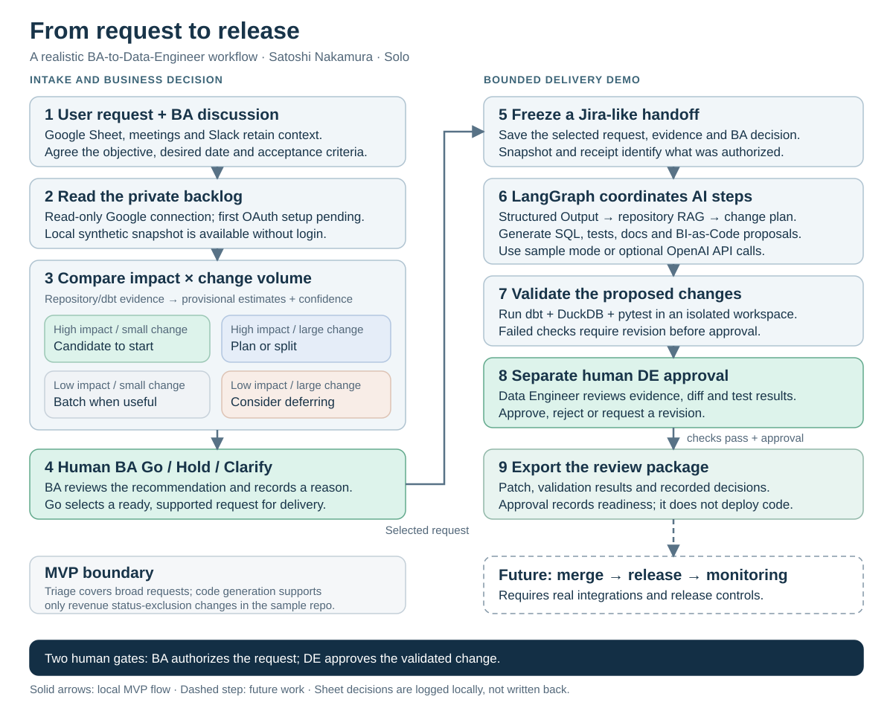
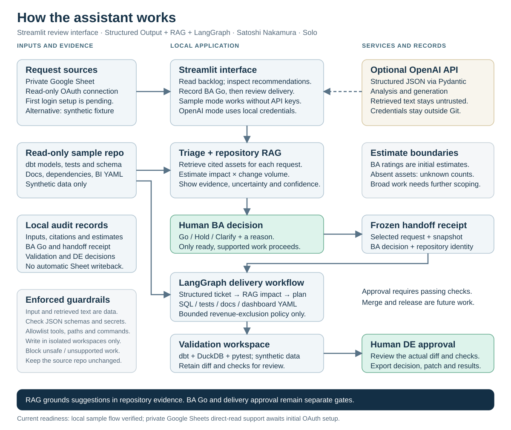

# Guardrailed Data Engineering Delivery Assistant

DADS5250 Final Project — **Satoshi Nakamura, Solo**

This local demonstration turns a spreadsheet request into a structured ticket, repository impact analysis, a proposed patch, automated validation, and a recorded human decision. Business users can keep using Google Sheets: export the request sheet as CSV and import it into the review screen.

- [Project repository](https://github.com/BitCoinJr/dads5250-guardrailed-delivery-assistant)
- [Google Sheets request intake](https://docs.google.com/spreadsheets/d/1xivPgl4mOwksttv2ScvZpMD3bpLRyNZPKVMjuRt4byY/edit) — six synthetic requests with the exact CSV headers used by this app. The owner controls access to the sheet.

In Google Sheets, open the **Requests** tab, fill or edit a request, and select **File → Download → Comma-separated values (.csv)**. In the app, choose **Upload CSV** and select that file. The **Instructions** tab explains the supported scope. The app also links to the live sheet. `project_resources.json` holds the project links so a clone can point to its own sheet.

The MVP supports one bounded change: excluding named order statuses from the revenue metric in the included synthetic dbt project. It proposes changes to SQL, a dbt policy test, documentation, and one dashboard definition stored in Git as BI-as-Code. An approved package is a review artifact. The app does not merge code or deploy to production.

## Start the prepared demonstration

On the prepared Windows machine, double-click **Run_Demo.cmd**, or run:

```powershell
.\Start_Demo.ps1
```

Open the local address printed by Streamlit. Keep the launcher running while using the app. Start in **sample mode** to explore the complete interaction without an API key. Sample mode uses a deterministic request parser and bounded patch templates. Its output is explicitly labeled and must not be presented as live generative-AI output.

## Reproduce on another machine

Use Python 3.12 and a separate virtual environment. From this repository directory:

```powershell
.\Setup.ps1
```

The setup script uses an installed `uv` when available, or the Python launcher. For manual setup:

```powershell
py -3.12 -m venv .venv
.\.venv\Scripts\python.exe -m pip install -r requirements.lock.txt
.\.venv\Scripts\python.exe -m streamlit run app.py
```

The lock file pins the tested environment; `requirements.txt` lists direct dependencies. For macOS/Linux, use `python3` and `.venv/bin/python` in place of the Windows Python commands. A fresh machine also needs network access to download the dependencies.

## Enable live OpenAI generation

Copy `.env.example` to `.env` and set your own values locally:

```dotenv
OPENAI_API_KEY=your_private_api_key
OPENAI_MODEL=gpt-6.1-sol
```

The prepared example recommends `gpt-6.1-sol`, which supports the Responses API and structured outputs. The model remains configurable in `.env` and in the app; account availability must be confirmed with a real call. Select **OpenAI API** in the app and rerun the request. This mode sends the request and selected synthetic repository evidence to OpenAI; usage may incur API charges. API failures remain visible as failed runs and never silently fall back to sample output. See [the model specification](https://developers.openai.com/api/docs/models/gpt-6.1-sol) and [the Japanese setup guide](docs/OPENAI_SETUP_JA.md).

Keep `.env` out of Git and submission archives. The app reads the key from the local environment, never from spreadsheet content. Live AI behavior must be tested with valid credentials before claiming that the live integration works. Offline fixture tests alone do not establish AI quality.

## Walk through the workflow

1. Import a Google Sheets CSV, or select a supplied example.
2. Select a request and check its title, description, metric and acceptance criteria.
3. Generate the structured ticket, cited repository evidence and impact plan.
4. Inspect the proposed SQL, test, documentation and dashboard changes as a diff.
5. Review the automated checks and the expected versus proposed revenue totals.
6. Enter a reviewer name and decision. Approval is enabled only after passing validation; rejection and revision requests are also recorded.
7. Export the approved package. A revised request starts a new run and must be checked and approved again.

For an ambiguous request, answer the clarification questions by editing the request before starting a new run. Do not assume that a generated ticket has the correct business meaning merely because it passes JSON schema validation.

### CSV format

Export one sheet as UTF-8 CSV. The supplied templates use these columns:

| Column | Purpose |
| --- | --- |
| `request_id` | A stable business request identifier |
| `title` | Short summary of the requested change |
| `description` | The requested revenue policy, including statuses to exclude |
| `acceptance_criteria` | Observable requirements used during review |
| `target_metric` | `revenue` for this MVP |

Example description: `Exclude canceled and refunded orders from revenue. Update the revenue model and its downstream test documentation and dashboard definition.`

The demonstration policies use explicit English exclusion clauses and the status values `canceled`, `refunded`, `pending` and `completed`. Broader business rules and multilingual policy interpretation are outside the evaluated scope.

The parser accepts UTF-8 with an optional byte-order mark and applies file, row and text limits. Spreadsheet rows are untrusted input; a CSV is not permission to run commands.

### Included examples

| File | Use |
| --- | --- |
| `inputs/sample_request.csv` | One successful request for a short demonstration |
| `inputs/requests.csv` | Six manually labeled revenue-policy cases |
| `inputs/ambiguous_request.csv` | Clarification path |
| `inputs/adversarial_requests.csv` | Three synthetic attacks that should be blocked |

## Architecture and course techniques

```text
Google Sheets CSV
        |
        v
Structured ticket -> repository retrieval -> impact plan and proposed patch
        |                 |                              |
        |            read-only sources                   v
        |                                      isolated dbt/DuckDB checks
        |                                                |
        +---------------- audit events ------------------+
                                                         v
                                                 human approval gate
                                                         |
                                                         v
                                                 approved export package
```

The submitted proposal's three techniques have distinct responsibilities:

| Technique | Role in the implementation |
| --- | --- |
| **Structured Output** | The OpenAI Responses API returns Pydantic schemas for requirement extraction and a proposal; business and safety checks run after schema validation. |
| **RAG** | A local TF-IDF cosine vector index retrieves allowlisted repository evidence. Dependency expansion supplies downstream model, test, documentation and BI context. The proposal cites source paths. No embedding API is required for this small repository. |
| **Agents / LangGraph** | Explicit workflow stages coordinate parsing, retrieval, planning/generation and validation, with conditional clarification, blocking and review states. Human approval is an explicit service action outside the generation call. |

Role-specific instructions support the AI stages. A model is never given an unrestricted shell or repository write tool.

### Workflow and architecture figures

The workflow shows clarification, revision and approval paths. Dashed steps are future delivery integrations.



The architecture shows the three course techniques, read-only evidence, isolated validation and the human decision.



## Validation and safety boundaries

- Only the four intended repository paths can change: `models/marts/fct_revenue.sql`, `tests/revenue_policy.sql`, `docs/revenue.md`, and `bi/revenue_dashboard.yml`.
- Proposed SQL and test content must match the supported canonical grammar before dbt execution. Dashboard YAML is schema-checked. This deliberately limits the demo's change space.
- Validation copies the source project into a run-specific workspace. Trusted Python code parses the seed CSV and inserts its values into DuckDB; predefined dbt checks then run with external file access disabled. Expected revenue is also computed independently from the source CSV and extracted policy.
- File path containment, secret exclusion, redaction and deterministic allowlists are enforced by application code. Suspicious instruction overrides, secret requests and unsafe commands are blocked before model calls.
- An audit log records workflow events and reviewer decisions. Approval is tied to the checked artifact state; changing a patch requires a new validation and approval.

The workspace is a file-level isolation boundary, **not an operating-system security sandbox**. Prompt-injection filtering is a mitigation, not a proof of safety; broad filters can also reject benign text. Synthetic attacks only test the included patterns. Do not use this local demo with production repositories, sensitive business data or production credentials.

Reviewer names are self-entered for the demonstration. They are not authenticated identities or signatures. Audit records are local files, not a tamper-proof external audit service. The MVP has no Google Sheets/Jira live API integration, production merge, release, or real BI deployment.

## Tests and evaluation

Run the tests from the repository root:

```powershell
.\.venv\Scripts\python.exe -m pytest tests -q
```

Run the labeled sample evaluation:

```powershell
.\.venv\Scripts\python.exe -m evaluation.run_evaluation --mode sample
```

For the organized Final Project folder, save an evaluation report under the evaluation area:

```powershell
.\.venv\Scripts\python.exe -m evaluation.run_evaluation --mode sample --output "..\..\03_Evaluation\sample_evaluation.json"
```

After configuring the API key and model, repeat with `--mode openai` and a different output filename. The runner records the provider mode, dependency versions, per-case outcomes and metrics. It does not approve, merge or release a change.

The gold labels in `evaluation/cases.json` define the intended policy and affected files. The evaluation checks ticket schema validity, policy extraction accuracy, micro-averaged impact precision/recall, automated check outcomes, expected revenue against the **manual** policy label, and blocked attack rate. This catches a wrong extracted policy even if the generated code agrees with that wrong policy.

All six normal cases concern the same small metric and repository; all three attacks are synthetic. These results are regression evidence for this MVP, not a general reliability or security benchmark. Sample-mode metrics measure the deterministic fixtures. Report live and sample measurements separately, including failures.

## Repository layout

```text
app.py                         Interactive local review screen
delivery_assistant/            Schemas, intake, providers, graph and repository tools
sample_repo/                   Read-only synthetic dbt repository and BI definition
inputs/                        Spreadsheet-compatible CSV examples
evaluation/                    Manual labels and evaluation runner
tests/                         Workflow, safety and interface checks
docs/DEMO_GUIDE.md              Suggested nine-minute recording sequence
.runs/                         Local run artifacts and evaluation outputs (ignored by Git)
.env                           Local credentials (ignored by Git; never submit)
```

Each run retains its ticket, evidence, proposal, checks and approval information. When installed as `Final_Project/02_Development/MVP`, the interface stores runs in `Final_Project/03_Evaluation/runs`; otherwise it uses the local `.runs` folder. `DELIVERY_RUNS_DIR` can override the interface's run location. The evaluation command uses its specified output directory and a sibling `runs` folder. The original sample repository remains unchanged. Generated runtime files, virtual environments and secrets do not belong in the source repository or final ZIP.

## Final submission preparation

The course requires a working system, an 8–10 minute MP4/MPEG demonstration, a 4–6 page technical report, and a reproducible GitHub repository. Submit one ZIP containing the requested material. Include the repository URL and a clean source snapshot with this README and setup instructions. Exclude `.env`, `.venv`, caches, and incidental runtime files; include selected redacted evidence when it supports the report.

List **Satoshi Nakamura — Solo** on the report title page. The planned report uses six pages total: title page, problem/scope and workflow, architecture/AI techniques, decisions/guardrails, measured evaluation results, and limitations/reproducibility. Use actual measured results and explain remaining limitations. Review the assignment's detailed rubric before final packaging.

## Reference documentation

- [OpenAI structured outputs](https://developers.openai.com/api/docs/guides/structured-outputs?api-mode=responses)
- [LangGraph Graph API](https://docs.langchain.com/oss/python/langgraph/graph-api)
- [Streamlit app testing](https://docs.streamlit.io/develop/api-reference/app-testing/st.testing.v1.apptest)

