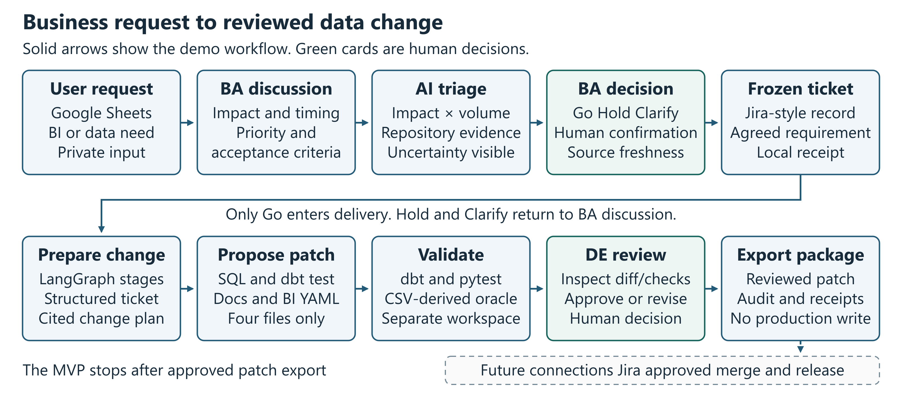
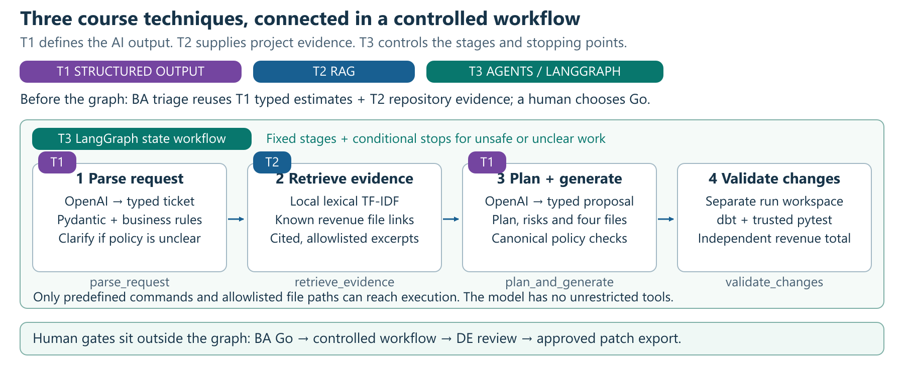

# Guardrailed Data Engineering Delivery Assistant

DADS5250 Final Project — **Satoshi Nakamura, Solo**

**For reviewers:** start with [How to setup & run](#how-to-setup--run) for a credential-free walkthrough.

## Executive summary

Business users need reliable BI, reporting and data changes, but their preferred starting point is often a spreadsheet. They discuss a request with a Business Analyst (BA), who clarifies its purpose, impact and timing before a Data Engineer (DE) begins work. Re-entering that request across tools can separate the implementation from the agreed business need.

This project follows a **Single Source of Truth (SSOT)** principle: preserve the agreed intent and its traceable handoffs throughout delivery. The private Google Sheet remains the intake record. After human BA Go, the app freezes the reviewed request in a Jira-style handoff and links it to the ticket, repository evidence, proposed changes, validation results and final review. These are linked, versioned artifacts, rather than one shared mutable database. A changed requirement needs a fresh review; it does not silently rewrite an accepted ticket.

The MVP combines **Structured Output**, **repository RAG** and **an agent workflow with LangGraph**. It helps the BA compare business impact with estimated change volume, then prepares a bounded four-file revenue-policy change for DE review. Actual automated checks support a separate human approval before patch export.

The longer-term aim is a clearer **Plan–Do–Check–Act (PDCA)** cycle: carry the request into a reviewed change, then use release outcomes and user feedback to inform the next request. The implemented boundary ends at an approved patch package. Production merge, release and the subsequent feedback loop remain future work.

- [Project repository](https://github.com/BitCoinJr/dads5250-guardrailed-delivery-assistant)
- [Google Sheets business request backlog](https://docs.google.com/spreadsheets/d/1xivPgl4mOwksttv2ScvZpMD3bpLRyNZPKVMjuRt4byY/edit#gid=20261115)
- [Google connection setup in Japanese](docs/GOOGLE_SHEETS_SETUP_JA.md)
- [OpenAI setup in Japanese](docs/OPENAI_SETUP_JA.md)

The normal workflow reads the private sheet directly; it does not require a CSV download and upload. The sheet remains read-only to the app. BA decisions are recorded locally, without changing sheet cells or sharing settings. A clearly separated synthetic **Demo backlog** is available before Google authentication is configured. Legacy CSV import remains an advanced fallback.

## Start the demonstration

On the prepared Windows machine, double-click **Run_Demo.cmd**, or run:

```powershell
.\Start_Demo.ps1
```

Open the local Streamlit address and start in **0 BA intake**. The two settings have different meanings:

| Setting | Choices | Meaning |
| --- | --- | --- |
| Backlog source | Demo backlog / Google Sheets | Synthetic local requests or a direct read of the configured private sheet |
| Generation mode | Sample walkthrough / OpenAI API | Deterministic sample rules and templates, or actual API generation |

Demo backlog with Sample walkthrough needs no credentials. Selecting Google Sheets requires Google OAuth setup. Selecting OpenAI API requires a local API key and model. The app labels the source and generation mode so a sample preview cannot be mistaken for a live read or an AI-generated result.

## Recorded verification and submission status

The following results were recorded on the prepared demonstration machine by November 16, 2026. Their scopes differ and must not be combined into a general AI accuracy claim.

| Verification | Recorded result | What it establishes |
| --- | --- | --- |
| Automated regression tests | 103 passed, 0 failed | Intake, safety, workflow and interface checks with synthetic or mocked integrations |
| Deterministic delivery evaluation | 6/6 normal cases validated; 3/3 synthetic attacks blocked; 1/1 ambiguous request paused | Bounded sample regression, with no live model quality measurement |
| Private Google Sheets read | 10 synthetic requests read by the connection script and running app refresh | Actual read-only connection; separate from the OpenAI example |
| Live OpenAI integration | One REQ-001 example with `gpt-6.1-sol`; 3 nominal API operations; 6/6 delivery validation checks passed | Actual API integration using the local synthetic fixture, not a live Google source in this run |
| Human decisions in the live API check | No BA Go, DE approval, export, merge or release recorded | The live check stopped awaiting actual human review |
| Recorded source and history secret audit | 0 credential findings; 13/13 exclusion checks passed | Source-publication check at that time; review again after changes |

The live example produced the expected synthetic revenue total of **770**, compared with a baseline of **920**. The independent acceptance oracle and source snapshots are preserved in the selected evidence. The four-file scope and small fixture set do not establish general reliability, broad prompt-injection resistance or accurate ranking across real business requests.

Final deliverables:

- [Technical report PDF](docs/final/DADS5250_Final_Report_Satoshi_Nakamura_Solo.pdf)
- [Editable technical report](docs/final/DADS5250_Final_Report_Satoshi_Nakamura_Solo.docx)
- [Demo recording guide PDF](docs/final/DADS5250_Demo_Recording_Guide_Satoshi_Nakamura_Solo.pdf)
- [Editable demo recording guide](docs/final/DADS5250_Demo_Recording_Guide_Satoshi_Nakamura_Solo.docx)
- [Selected verification summary](docs/final/evidence/verification_summary.json)
- [Section recording scripts and pronunciation notes](docs/final/Audio_Scripts/00_START_HERE_JA.txt)
- [First recording section](docs/final/Audio_Scripts/01_intro.txt)

**Completed demonstration:** A later end-to-end recording uses the private Google Sheet and actual OpenAI mode, passes all six delivery checks, records the author's approval and exports the reviewed patch. Satoshi Nakamura reviewed the complete **9-minute 48-second** video and confirmed it on November 16, 2026. The MP4 and timed English subtitles are included in the submission ZIP; media files are kept outside the source repository. This recorded run is separate from the earlier checks above. The repository is public for final submission; credentials and the private demonstration sheet are not shared.

Reviewers can reproduce the synthetic workflow with **Demo backlog + Sample walkthrough** without credentials. Publishing the source does not share the author's private Google Sheet or OAuth access. Actual Google mode needs separately permitted access to the fixed demonstration sheet, or a deliberate adaptation of the sheet allowlist; actual OpenAI mode needs the reviewer's own local API configuration.

## Realistic intake and two human decisions

1. The business user records a request and discusses its purpose with the BA.
2. The user and BA refine acceptance criteria, business impact, priority, timing and readiness in the sheet.
3. In **BA intake**, refresh the source, choose up to 30 requests, and select a planning date.
4. Select **Estimate impact and change volume**. Inspect the matrix, recommendation reasons, confidence and retrieved dbt evidence.
5. The BA chooses a request, enters a decision rationale and explicitly records **Go**, **Hold** or **Clarify**. A recommendation does not start development.
6. For a valid Go, **1 Request** displays the frozen handoff. Select **Prepare and validate** to create the structured delivery ticket, evidence, plan, proposed patch and validation report.
7. Inspect **2 Evidence and plan** and **3 Changes and checks**. A Data Engineer then reviews the evidence and records the final decision in **4 Human review**.
8. Only an approved, unchanged validation result can be exported as an approved patch package.

The BA Go decides whether a request is ready to start. The later Data Engineer approval decides whether the prepared patch is acceptable. Neither action executes a production merge or release. A real Jira service is not required for the demo; the handoff and ticket are Jira-style local records.

### What the matrix means

| Estimated business impact | Estimated change volume | Discussion to have |
| --- | --- | --- |
| High | Small | Consider starting after confirming readiness and timing |
| High | Large | Scope the work or split it into phases |
| Low | Small | Batch it when capacity is available |
| Low | Large | Defer or revisit the business case |

Requests with insufficient information stay outside the four quadrants under **Needs estimation**. A missing BA impact rating is not silently filled with a neutral number. Draft rows can keep impact blank, priority Unassigned, effort Unknown, BA status New and decision Pending until the discussion is complete.

The change-volume estimate uses retrieved dbt assets and dependency context. For the supported existing revenue policy, the app compares the canonical proposed templates with the source and can show the number of changed SQL models, affected files and added/removed text lines. Those are **provisional template-based scope estimates**, not actual generated-patch measurements or working hours. Broad new dashboards, new sources or extraction requests may have unknown counts and low-confidence assumptions until they are scoped.

BA priority, desired date and initial effort remain visible as secondary planning inputs. The optional rubric is transparent guidance, not financial ROI, an objective business-value score or an automatic Go rule.

### Frozen Go and freshness

Before recording a decision, the app rereads the selected source and checks that the reviewed queue has not changed. A Go receipt binds the reviewed request, its business fields and repository estimate. The delivery screen verifies the receipt and keeps those request fields fixed. To change the requirement, update the source and repeat BA intake rather than editing the frozen ticket. A later sheet edit does not silently rewrite an existing ticket. Changes to the inspected repository assets invalidate the old estimate and handoff.

## Delivery scope

The backlog can represent BI changes, data extraction, new dashboards and other real requests. Automatic delivery remains intentionally narrow: an explicit English request to exclude named order statuses from the existing `revenue` metric in the supplied synthetic dbt project. Supported statuses are `canceled`, `refunded`, `pending` and `completed`.

The proposed patch changes four allowlisted files together:

- `models/marts/fct_revenue.sql`
- `tests/revenue_policy.sql`
- `docs/revenue.md`
- `bi/revenue_dashboard.yml`

Only clarified, supported requests with the required BA readiness and business assessment can receive Go for this delivery path. Broader work stays visible with **Scope review**, **Hold** or **Clarify** guidance; ranking it does not make it implementable. Production merge/release, actual Jira integration and real BI deployment remain future work.

## Workflow and architecture

Read Figure 1 from left to right: the business user and BA use Google Sheets, the BA uses Streamlit intake, the local backend prepares and checks the change, and the DE reviews it in the same app. Google Sheets and OpenAI are external services; the app and validation workspace run locally. Dashed release and feedback steps show the future PDCA loop.



[Figure 1 scalable SVG](docs/final/figures/01_Business_Workflow.svg)

Figure 2 uses the same **T1 / T2 / T3** labels as the report and table below. **T1 Structured Output** appears at triage, request parsing and proposal generation. **T2 RAG** supplies evidence to triage and planning. **T3 Agents / LangGraph** surrounds the four delivery nodes; human Go and approval remain outside it.



[Figure 2 scalable SVG](docs/final/figures/02_System_Architecture.svg)

The three course techniques have separate responsibilities:

| Technique | Role |
| --- | --- |
| T1 Structured Output | Pydantic schemas define AI triage recommendations, requirement extraction and implementation proposals; business checks run after schema validation |
| T2 RAG | Local lexical TF-IDF retrieval and fixed revenue dependency expansion retrieve allowlisted dbt/repository evidence for scope estimates and delivery plans; citations must match retrieved paths |
| T3 Agents / LangGraph | Explicit delivery stages coordinate parsing, retrieval, planning/generation and validation, with clarification and safety branches |

Role-specific prompts support the AI stages. Human BA decisions and final approvals are explicit service operations outside model generation.

## How to setup & run

### 1. Get the source and prerequisites

The verified reviewer path is **Windows x64 with Python 3.12**. Install [uv](https://docs.astral.sh/uv/getting-started/installation/) on PATH (recommended; the setup script obtains Python 3.12), or provide Python 3.12 through the Windows `py` launcher. Dependency installation needs internet access.

Download and extract this repository, or use **`03_Code` from the submission ZIP**. Open PowerShell in the folder containing `app.py`, `Setup.ps1` and `requirements.lock.txt`. The public repository and the submission ZIP provide the same clean source snapshot.

### 2. Install and start

Run these commands from that folder:

```powershell
powershell.exe -NoProfile -ExecutionPolicy Bypass -File .\Setup.ps1
powershell.exe -NoProfile -ExecutionPolicy Bypass -File .\Start_Demo.ps1 -NoBrowser
```

Wait until the terminal displays the app URL, then open **http://127.0.0.1:8501** in your browser. Keep the launch terminal open. The execution-policy option applies to these processes; it does not change the machine's policy. Setup creates the project's own `.venv` and installs `requirements.lock.txt`.

If port 8501 is occupied, run the launcher with a different port, then open that port in the browser:

```powershell
powershell.exe -NoProfile -ExecutionPolicy Bypass -File .\Start_Demo.ps1 -Port 18501 -NoBrowser
```

### 3. Walk through the sample without credentials

The following path uses local synthetic requests and deterministic sample generation. It needs no OpenAI API key or Google sign-in and makes no Google/OpenAI API calls.

1. Keep **Generation mode = Sample walkthrough** and **Backlog source = Demo backlog** in **0 BA intake**. Ten requests load automatically.
2. Set **Planning date = 2026-11-16**, then select **Estimate impact and change volume**. This fixed date makes the planning context repeatable.
3. Select **REQ-001** under **Request for BA decision**. Enter a BA reviewer name and a decision rationale, select **Go**, check the business-review acknowledgment, and select **Record BA decision**.
4. In **1 Request**, inspect the frozen handoff, then select **Prepare and validate**.
5. Inspect **2 Evidence and plan**, then select **Review changes and checks**. In **3 Changes and checks**, expect **six PASS checks**, original revenue **920.00**, proposed revenue **770.00** and expected revenue **770.00**.
6. Select **Continue to human review**. Enter a reviewer name, check **I reviewed the evidence, diff and validation results**, and select **Approve patch**. Approval stays disabled until that separate acknowledgment is checked.
7. Select **Download approved patch package**. The ZIP contains the four-file proposal, validation and review records. Approval exports a reviewed patch; it does not merge or release it.

To stop the app, press **Ctrl+C** in the launch terminal. You can restart it with the same launch command.

### 4. Verification and optional live services

This path was checked on Windows using a fresh copy of tracked source, a new Python 3.12 environment and the locked dependencies: installation, local server startup and the sample BA Go → validation → review → export workflow. The reproduction record is `04_Evidence/reviewer_setup_verification.json` in the submission ZIP. This credential-free check does not measure live AI quality.

Google Sheets and OpenAI are optional modes with separate local setup, permissions and credentials; follow the two guides below when using them. Keep credentials outside Git. The author's private Google Sheet is not automatically shared with reviewers.

For a manual Python environment, the equivalent installation is below. The automated reproduction used the Windows `uv` route above; macOS/Linux have not been verified.

```powershell
py -3.12 -m venv .venv
.\.venv\Scripts\python.exe -m pip install -r requirements.lock.txt
.\.venv\Scripts\python.exe -m streamlit run app.py --server.address=127.0.0.1
```

`requirements.lock.txt` pins the environment; `requirements.txt` lists direct dependencies.

### Connect the private Google Sheet

Follow [the Google setup guide](docs/GOOGLE_SHEETS_SETUP_JA.md). Create a Google Desktop OAuth client, keep its JSON in the ignored `.secrets` folder, then run:

```powershell
.\.venv\Scripts\python.exe scripts\connect_google.py
```

Complete the Google login and consent yourself. The scope is `spreadsheets.readonly`; Google grants that read scope at account level, while this app restricts its reads to the configured sheet ID and `Request backlog!A3:T200`. The app does not use public CSV endpoints, browser cookies, a service-account key or a write scope. It does not open a login window automatically when the page loads.

Google authorization is independent of the OpenAI API key. On the author's prepared machine, the connection script and running app each successfully read the ten synthetic backlog rows. On another machine, verify the credentialed private-sheet connection after local OAuth setup; synthetic or mocked tests alone do not prove a successful live Google read.

### Enable actual OpenAI generation

Copy `.env.example` to `.env` and set values locally:

```dotenv
OPENAI_API_KEY=your_api_key_here
OPENAI_MODEL=gpt-6.1-sol
```

The prepared recommendation is `gpt-6.1-sol`; a model available to the account can be selected in the app. Actual AI mode sends the selected request data and allowlisted repository excerpts to OpenAI and may incur API charges. Failed API runs remain failures and never silently fall back to sample output. See [the model specification](https://developers.openai.com/api/docs/models/gpt-6.1-sol) and [the Japanese setup guide](docs/OPENAI_SETUP_JA.md).

A credentialed one-request live integration has been recorded with `gpt-6.1-sol`: three nominal API operations, all six delivery validation checks passed, and the result remained awaiting human review. That example used the synthetic local backlog fixture; it was separate from the live Google read. On another machine, verify API generation after local setup. Sample-mode estimates and successful local validation are not evidence of live model quality.

## Validation and safety boundaries

- Spreadsheet cells, retrieved text and model output remain untrusted data. The model cannot access an unrestricted shell, change sharing or write to the source repository.
- The Google reader uses a fixed file/range allowlist and read-only authorization. BA decisions are local records rather than spreadsheet writes.
- Generated SQL and policy tests must match the bounded revenue-policy grammar before execution. BI YAML and documentation must agree with the reviewed policy.
- Validation stages changes only in a run-specific workspace. Trusted Python parses synthetic seed data into DuckDB; fixed dbt commands run with external file access disabled. Independent pytest checks compare daily results with the CSV-derived acceptance oracle.
- A BA Go is bound to its reviewed input and scope estimate. Final patch approval is bound to the checked proposal and workspace; changing either requires another review.
- Secret-shaped inputs, prohibited instructions and unsafe paths are blocked or redacted. `.env`, `.secrets`, token files, virtual environments and generated runtime artifacts are excluded from Git and submission archives.

This is a local demonstration with file-level isolation, not an operating-system security sandbox. Pattern filters are mitigations and can both miss attacks and reject benign text. Reviewer names are self-entered, not authenticated identities; local audit files are not a tamper-proof external audit service. Use the synthetic repository and examples rather than production data or credentials.

## Tests and evaluation

```powershell
.\.venv\Scripts\python.exe -m pytest tests -q
.\.venv\Scripts\python.exe -m evaluation.run_evaluation --mode sample
```

The automated pytest suite disables local dotenv loading and clears inherited OpenAI credentials and routing for each test. Tests supply synthetic or mocked integrations explicitly; live API verification is a separate operation.

The existing labeled evaluation runner covers the bounded delivery component: ticket schema, extracted policy, affected-file precision/recall, automated validation, revenue against manual gold labels, and synthetic attack blocking. It does not by itself benchmark the new backlog-ranking or two-axis estimation quality. Separate tests cover triage eligibility, missing estimates, asset citations, stale inputs and frozen Go receipts.

For the organized Final Project folder, save the delivery evaluation in its evaluation area:

```powershell
.\.venv\Scripts\python.exe -m evaluation.run_evaluation --mode sample --output "..\..\03_Evaluation\sample_evaluation.json"
```

For a broader live evaluation, use `--mode openai` and a separate output file after local setup; this makes additional API requests and may incur charges. The recorded one-request integration is not a full live benchmark. Record the actual commands, provider/source mode, dependency versions, failures and measured results. The small synthetic fixture set is regression evidence, not a general reliability or security benchmark. Do not reuse earlier counts or planned results as measurements of a changed system.

## Repository layout

```text
app.py                         Local delivery review interface
delivery_assistant/backlog_ui.py  BA intake and matrix screen
delivery_assistant/triage.py    Evidence-based estimates and human Go receipts
delivery_assistant/google_sheets.py  Restricted private-sheet reader
delivery_assistant/            Schemas, AI provider, LangGraph and validation tools
scripts/connect_google.py      Explicit one-time Google sign-in command
sample_repo/                   Read-only synthetic dbt project and BI definition
inputs/backlog_demo.json       Synthetic realistic request queue
inputs/*.csv                   Advanced fallback and delivery regression fixtures
evaluation/                    Manual labels and delivery evaluation runner
tests/                         Intake, safety, workflow and interface checks
docs/                          Google/OpenAI setup and recording guide
project_resources.json         Project and sheet links
.runs/                         Ignored local runtime data when installed standalone
.secrets/                      Ignored local Google OAuth configuration and token
.env                           Ignored local OpenAI configuration
```

When installed in `Final_Project/02_Development/MVP`, the app stores run and triage artifacts under `Final_Project/03_Evaluation/runs`; otherwise it uses local `.runs`. `DELIVERY_RUNS_DIR` can override storage. Runtime data stays outside source control. Each record retains the input snapshot, evidence, recommendation, decision or validation appropriate to its stage.

The `Request backlog` sheet uses grouped business-request, BA-review and delivery-tracking columns. `Instructions` explains the process. Original `Requests` CSV examples remain available for compatibility; they are not the normal intake path. Advanced CSV import expects `request_id`, `title`, `description`, `acceptance_criteria`, and `target_metric` headers, rather than the formatted backlog's title bands and human-readable headers.

## Final submission

The course requires a functional system, an 8–10 minute MP4/MPEG recording, a 4–6 page technical report and a reproducible GitHub repository. Submit the requested material in one ZIP with the repository URL and a clean source snapshot. Include selected redacted evidence when it supports the report; exclude `.env`, `.secrets`, `.venv`, caches, tokens and incidental runtime files.

The linked technical report identifies **Satoshi Nakamura — Solo** and covers the problem and workflow, architecture and course techniques, engineering decisions and guardrails, recorded results, limitations and reproducibility. The completed video presents the functional workflow with the author's narration and timed English captions. The recording guide and scripts are preparation material; the final MP4 and SRT are included in the submission ZIP. Review the attached course rubric and confirm repository access before submitting.

## Team Contributions

| **Member** | **Implemented work** | **Review and integration** |
| --- | --- | --- |
| Satoshi Nakamura (Solo) | Project scope and requirements, application development with AI assistance, evaluation, documentation, and presenter narration | Reviewed the integrated workflow and results, approved the demo change, and reviewed the completed report and recording |

## References

- OpenAI. [Responses API — Python reference](https://developers.openai.com/api/reference/python/resources/responses).
- OpenAI. [Structured model outputs](https://developers.openai.com/api/docs/guides/structured-outputs?api-mode=responses).
- Google. [Google Sheets API — Python quickstart](https://developers.google.com/workspace/sheets/api/quickstart/python).
- Google. [Google Sheets API — spreadsheets.values.get](https://developers.google.com/workspace/sheets/api/reference/rest/v4/spreadsheets.values/get).
- Google. [OAuth 2.0 for Desktop Apps](https://developers.google.com/identity/protocols/oauth2/native-app).
- LangChain. [LangGraph Graph API overview](https://docs.langchain.com/oss/python/langgraph/graph-api).
- Streamlit. [AppTest API reference](https://docs.streamlit.io/develop/api-reference/app-testing/st.testing.v1.apptest).
- dbt Labs. [dbt build command](https://docs.getdbt.com/reference/commands/build).
- OpenAI. [File transcription](https://developers.openai.com/api/docs/guides/speech-to-text) (demo caption preparation).

## AI-use Disclosure

AI assisted with code development, debugging, and drafting the report, diagrams, documentation and demo materials. The author reviewed the implementation, numerical outputs and final deliverables and is responsible for the submission.

